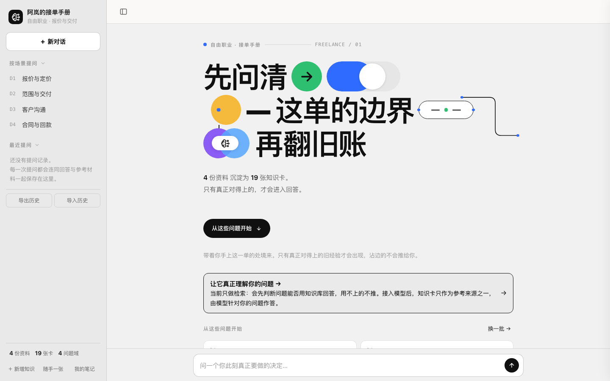
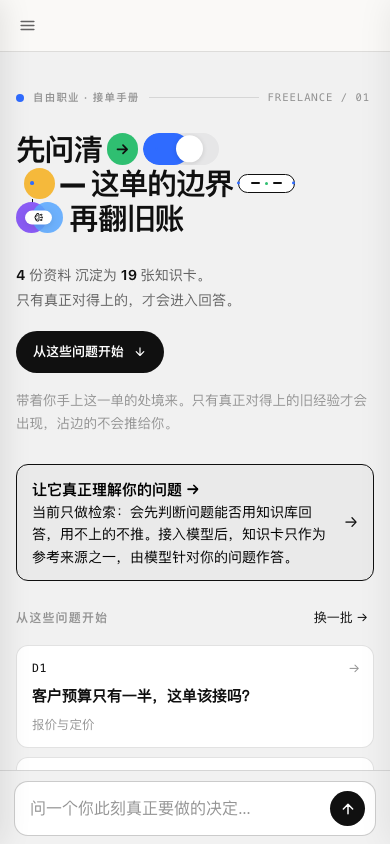
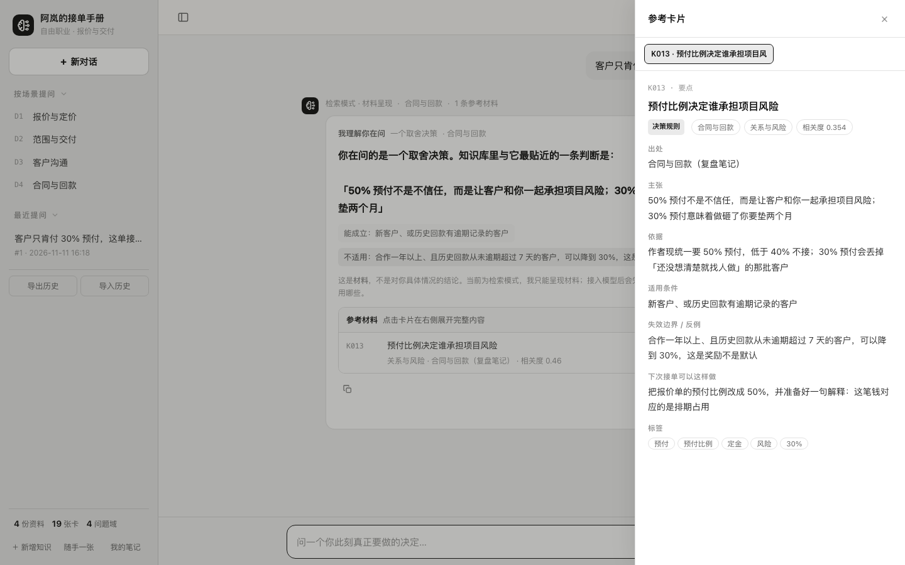
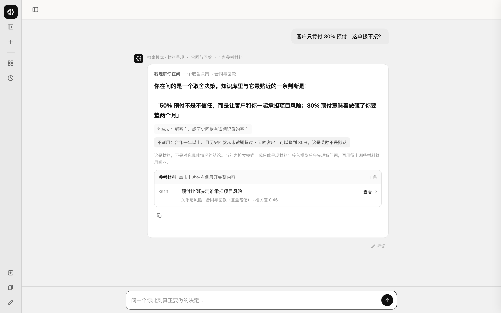

# Second Brain Skill

[](https://github.com/allenxie0510/second-brain-skill/actions/workflows/ci.yml)
[](LICENSE)
[](https://www.python.org/)
[](#安装)

把一堆原始资料（笔记 / 文档 / PDF / 书单 / 课程 / 访谈 / 聊天记录）编译成一个**自包含的"第二大脑"单页应用**：
单文件、零依赖、断网可用，检索全在浏览器里跑，模型由使用者自己接。

> 不是「文档问答机器人」，而是**以问题为索引的判断库**——每张卡是一个可判断、可反驳的主张，
> 带适用条件、失效边界和一个能立刻执行的动作。



<p align="center">
  
  
</p>

<p align="center">
  
  
</p>

## 它做了什么

```
原始语料 ──切块──▶ 语义块 ──LLM──▶ 原子知识卡 ──▶ 单文件站点
(md/pdf/docx…)     (80–1500 字)     (claim/条件/边界/动作)   检索内联 + 模型直连
```

- **构建期**：切块 → 设计问题域 → 逐块提炼知识卡 → 跨资料归纳综合卡 → 内联成 `dist/index.html`
- **使用期**：意图路由 → 字符 n-gram TF-IDF 召回 → 双门槛过滤 → Top-N 卡片作为 context 交给用户的模型
- **回写**：对话中发现库里没有的判断，可以「＋ 新增知识」让 AI 整理成卡写回本地

## 快速开始

```bash
git clone https://github.com/allenxie0510/second-brain-skill.git
cd second-brain-skill

python3 engine/sbs.py new ~/我的第二大脑 --title "我的第二大脑" --sub "垂类 · 知识库"
# 把资料丢进 ~/我的第二大脑/sources/
export SBS_BASE=https://api.deepseek.com SBS_MODEL=deepseek-chat SBS_KEY=sk-xxx
python3 engine/sbs.py all ~/我的第二大脑
open ~/我的第二大脑/dist/index.html
```

一条 `all` = 切块 → 问题域 → 知识卡 → 构建 → 自检。每步也能单跑，`cards` 支持断点续跑。

**没有模型 Key 也能先跑起来**：`new` / `ingest` / `plan --no-llm` 不需要模型；配好 Key 后再 `sbs.py cards` 接着生成即可。
**想看效果**：`examples/demo/` 带预置夹具（4 篇虚构笔记 → 19 张卡），配好 Key 后直接 `build` + `verify` 就能看到完整成品。

### 安装

零第三方依赖，只要 Python ≥ 3.10。唯一例外是 PDF：

```bash
# macOS
brew install poppler          # 提供 pdftotext
# 或任意平台
pip install pypdf             # 纯 Python 兜底
```

### 模型配置

优先级：环境变量 > 项目 `brain.json` 的 `llm` 字段 > `~/.config/second-brain/config.json`。
任何 OpenAI 兼容端点都可以：

| 服务 | Base URL | 示例模型 |
|---|---|---|
| DeepSeek | `https://api.deepseek.com` | `deepseek-chat` |
| Kimi | `https://api.moonshot.cn/v1` | `moonshot-v1-8k` |
| 智谱 | `https://open.bigmodel.cn/api/paas/v4` | `glm-4-flash` |
| 通义 | `https://dashscope.aliyuncs.com/compatible-mode/v1` | `qwen-plus` |
| OpenAI | `https://api.openai.com/v1` | `gpt-4o-mini` |
| 本地 | `http://127.0.0.1:8000/v1` | 你的 vLLM / Ollama 模型名 |

生成知识卡建议用**指令遵循较好**的模型：太弱的模型会产出「XX 很重要」这类空话卡（会被自动丢弃，但浪费调用）。

## 命令

| 命令 | 作用 | 常用参数 |
|---|---|---|
| `sbs.py new <dir>` | 新建项目骨架 | `--title --sub --hero "三行\|字\|文案"` |
| `sbs.py ingest <dir>` | 读资料、切语义块 | `--limit-docs N` 先试几份 |
| `sbs.py plan <dir>` | 设计问题域（检索路由） | `--no-llm` 用文件名兜底 |
| `sbs.py cards <dir>` | 生成知识卡 + 综合卡 | `--max-chunks N --no-synth --sleep S` |
| `sbs.py build <dir>` | 构建单文件站点 | 改完 `brain.json` 重跑即可 |
| `sbs.py verify <dir>` | 自检：结构 + 逐题命中报告 | 失败退出码 1（可进 CI） |
| `sbs.py all <dir>` | 上面全部 | 组合参数同上 |

### 产物结构

```
我的第二大脑/
├── brain.json          # 品牌/人设/头图文案/问题域（可版本管理）
├── sources/            # 你的原始资料
├── data/
│   ├── chunks.jsonl    # 语义块
│   ├── taxonomy.json   # 问题域（plan 产物，建议人工审）
│   ├── cards.raw.jsonl # 逐块原始输出（断点续跑用，别删）
│   └── cards.json      # 最终知识卡
├── tests/questions.json # verify 生成的问题清单 → 你的回归测试
└── dist/
    ├── index.html      # 成品：单文件、零外链
    ├── brain-data.json # 数据快照（便于二次加工）
    └── 打开知识库.command
```

## 边界条件

### 资料格式

| 格式 | 支持 | 说明 |
|---|---|---|
| `.md` `.markdown` | ✅ | 最佳。按标题层级切块，语义块最准 |
| `.txt` `.csv` `.tsv` `.json` `.log` `.rst` | ✅ | 按段落合并切块 |
| `.html` `.htm` | ✅ | 自动剥掉 script/style/nav/footer/header |
| `.docx` `.epub` | ✅ | 纯标准库解析 |
| `.pdf` | ⚠️ | 需要文字层；**扫描版不支持**（无 OCR），先自行 OCR |
| 图片 / 音频 / 视频 | ❌ | 先转文字 |
| **网址 URL** | ❌ | 不内置抓取，见下 |

### "给个网址就能总结吗"

不内置，这是刻意的取舍：抓网页要处理反爬、正文抽取、动态渲染，会引入大量依赖并破坏「零依赖单文件」。变通：

```bash
curl -sL "https://example.com/article" > sources/文章标题.html   # 引擎能解析 HTML
# 或用浏览器「另存为 / 复制为 Markdown」放进 sources/
```

批量抓站可配合 `wget --mirror` 或 readability 类工具，抓完按普通资料跑管线。

### 规模

| 维度 | 舒适区 | 边界与后果 |
|---|---|---|
| 语义块 | 350–700 字 | 硬上限 1500 字，超了会被切开，卡面变碎 |
| 原始语料 | 3 万–30 万字 | < 1 万字问题域过拟合，检索互相干扰 |
| 知识卡 | 50–500 张 | 1000 张内流畅；单页体积随卡片线性增长 |
| 问题域 | **6–9 个** | 4 个可跑（示例就是 4 个）；少了互相干扰，多了每域样本不足 |
| 产物 | < 2 MB | ≈ 5 MB 为双击体验上界；CI 有 2 MB 守门 |

**成本**：约 1 次模型调用 / 语义块。1 万字 ≈ 15 块 ≈ 15 次；10 万字 ≈ 150 次。
先 `--max-chunks 10` 看产出质量，再全量。

### 隐私

- **构建期**：语料以语义块发给**你自己配置的**模型端点；用本地 vLLM/Ollama 则完全不出本机
- **使用期**：`dist/index.html` 是纯静态页，检索在浏览器完成；只有提问时，问题 + 命中的卡片会发给你在「设置」里填的端点
- 笔记与用户新增卡片默认存本机 localStorage，可导出 JSON 备份

## 做一个垂类知识库（推荐七步）

1. **选料**：挑带判断的资料（复盘、案例、方法论），删掉寒暄、时间戳、纯事实流水账
2. **试跑**：`ingest --limit-docs 3` + `cards --max-chunks 10`，质量不对先调模型或资料
3. **改问题域**：`plan` 后人工过一遍——把书面词换成口语词（「砍价」「拖款」「来不及」），补 3–5 个带情境的问题。**这是检索质量的第一决定因素**
4. **全量生成**：`cards`（断了直接重跑，自动续）
5. **自检调优**：`verify` 逐题看 Top1；错了就给正确卡补口语检索标签（加在 `tags` 最前面），重跑 `build + verify`
6. **品牌化**：`brain.json` 的 `persona`（人设）、`hero`（三行大字）、`scope`（覆盖范围）、`offtopic`（本行业"看起来像但库里没有"的词）
7. **分发**：`dist/` 打包发人，或传 Vercel / Cloudflare Pages / 对象存储

## 让 AI Agent 替你执行

仓库自带 [`SKILL.md`](SKILL.md)（Agent 执行手册）：任何能执行 shell 的模型助手读到本仓库，都能按手册完成
「建项目 → 审查问题域 → 试跑卡片 → 构建自检 → 按命中报告迭代」，并包含**未配置模型时的降级路径**与**交付自查清单**。

把仓库路径给 Agent，说「把 sources 里的资料做成第二大脑」即可。

## 云端模式（可选）

默认纯本地。想要公网访问 + 笔记跨设备同步 + Key 不落访客浏览器：按 [`docs/cloud-mode.md`](docs/cloud-mode.md)
在 Vercel 部署 `api/proxy`（模型代理）与 `api/notes`（AES-256-GCM 加密笔记），然后 `brain.json` 设 `"cloud": true` 并重跑 `build`。

## 架构与取舍

| 决策 | 原因 |
|---|---|
| 不用向量库 / embedding | 几百张卡规模下，字符 n-gram TF-IDF + 意图路由足够准，换来零成本、零延迟、断网可用、语料不出本机。语义索引在构建期已完成——卡片的 `tags` / `keywords` / `typical_questions` 就是索引 |
| 检索粒度是「判断」不是「文档」 | 以文档为粒度永远召回模糊摘要；以一条可判断的主张为粒度，才能回答「这单该不该接」 |
| 产物是单文件 | 数据内联、零外链（`build` 自带校验，出现外链直接退出）→ 双击即用、可邮件发送、可离线 |
| 模型 Key 归使用者 | 页面不落 Key，浏览器直连；需要"Key 不进浏览器"时才上云端模式 |

## FAQ / 排错

**Q：跑完 `cards` 只有几张卡？**
正常。管线宁可少不要重复：`claim` < 8 字、`limits` 是「无 / 视情况而定」的卡会被丢弃。检查原始资料是不是缺少判断句。

**Q：`verify` 命中率低于 80%？**
先补该问题域的 `keywords` / `typical_questions`，**不要急着调检索权重**。这是 90% 情况下的真因。

**Q：本机模型服务返回 501 / 连接被拒？**
系统代理（如 `HTTP_PROXY=127.0.0.1:9090`）把 localhost 请求也代理了。`llm.py` 对 `127.0.0.1` / `localhost` 已关闭代理；自建服务时也注意 `no_proxy`。

**Q：PDF 读不出来？**
扫描版没有文字层，需先 OCR；普通 PDF 装 `poppler`（`pdftotext`）或 `pypdf`。

**Q：`打开知识库.command` 双击没反应（macOS）？**
首次可能被 Gatekeeper 拦。右键 → 打开；或直接在终端 `chmod +x` 后运行。也可以直接双击 `index.html`。

**Q：改了卡片但页面没变？**
`dist/index.html` 是快照，改完数据必须重跑 `sbs.py build`。

**Q：中途断了要重新花钱吗？**
不会。`cards.raw.jsonl` 记录已完成块，重跑自动跳过；**别删这个文件**。

## 开发与测试

```bash
python -m compileall engine                    # 语法
cp -r examples/demo /tmp/demo && \
  python engine/sbs.py build  /tmp/demo && \
  python engine/sbs.py verify /tmp/demo        # 期望：12/12 命中，离题 0 误推
```

CI（[`.github/workflows/ci.yml`](.github/workflows/ci.yml)）在 Python 3.10 / 3.13 上跑：
语法检查 → 无模型骨架流程 → 构建 + 检索自检 → 零外链校验 → 单文件 < 2 MB 守门。
不需要任何 API Key。

## 贡献

- 提 issue 请附：语料类型、`verify` 报告片段、模型名
- 改检索逻辑前先跑 `verify` 存基线，提交时给「逐题 Top1 对比」，不要只看总分
- 新增格式解析放 `engine/extract.py`，保持**仅标准库**（可选依赖必须带降级）

## License

[MIT](LICENSE)
